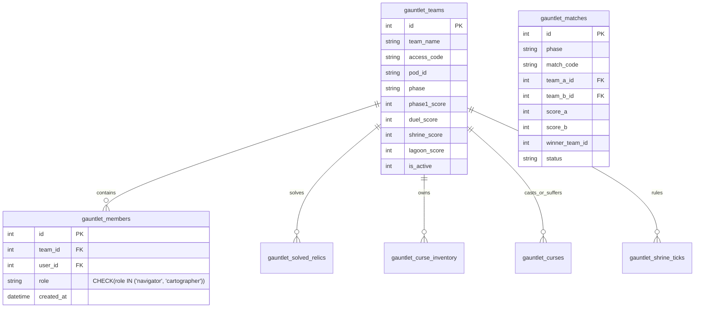

# 🏗️ System Architecture & Technical Topology

This document details the architectural topology, data models, container isolation boundaries, and real-time state synchronization engines of the Technozion SDC Games CTF Platform.

---

## 1. System Topology Overview

```
                                  [ CLIENTS / BROWSERS ]
                                             |
                                             v
                               [ Nginx Reverse Proxy (80 / 443) ]
                                 - SSL Termination (Let's Encrypt)
                                 - WebSocket Upgrade Headers
                                             |
                                             v
                                   Port 8080 (HTTP / WSS)
                                   [ DAY 1/www/app.py ]
                                  (Flask + Flask-SocketIO)
                                             |
                      +----------------------+----------------------+
                      |                      |                      |
                      v                      v                      v
              [ SQLite 3 DB ]        [ gauntlet_engine ]    [ Host Docker Daemon ]
             (jumanji_auth.db)       - Split-key HMAC       - PTY pseudo-terminals
             - Users & Roster        - Bracket promotions   - Per-player containers
             - Solved Relics         - Live KotH ticks      - No host mounts
             - Curses & Inventory    - Top 4 Qualifiers     - Ephemeral lifetime
                      ^
                      | (Optional Roster Sync)
              [ MongoDB Atlas ]
             (Cluster: sdcgames26)
```

---

## 2. Docker Sandboxing & Terminal Container Topology

Each participant requiring terminal access interacts with an isolated container spawned via pseudo-terminal (`pty.openpty()`):

```
+--------------------------------------------------------------------------------+
| DOCKER HOST (macOS / Linux)                                                    |
|                                                                                |
|   +------------------------------------------------------------------------+   |
|   | DAY 1 LEVEL 2 CONTAINER: jumanji-level2:latest                        |   |
|   | - User: recon_user (non-root)                                          |   |
|   | - Setup: /usr/local/bin/setup_level2.sh                                |   |
|   | - Puzzles: Sudo find, hidden dotfiles, loopback HTTP :5000, process ps |   |
|   +------------------------------------------------------------------------+   |
|                                                                                |
|   +------------------------------------------------------------------------+   |
|   | DAY 1 LEVEL 3 CONTAINER: jumanji-level3:latest                        |   |
|   | - User: recon_user (non-root)                                          |   |
|   | - Setup: /usr/local/bin/setup_level3.sh                                |   |
|   | - Puzzles: SUID binary /usr/local/bin/lift_curse (CHANT required)      |   |
|   +------------------------------------------------------------------------+   |
|                                                                                |
|   +------------------------------------------------------------------------+   |
|   | DAY 2 LEVEL 2 GAUNTLET CONTAINER: jumanji-gauntlet:latest              |   |
|   | - User: recon_user (non-root)                                          |   |
|   | - Environment: TEAM_ID, TEAM_NAME, TEAM_ROLE, PHASE                    |   |
|   | - Self-Cleanup: rm -f /usr/local/bin/setup_gauntlet.sh on completion  |   |
|   | - Security: ZERO host volume mounts (secrets protected)                |   |
|   +------------------------------------------------------------------------+   |
+--------------------------------------------------------------------------------+
```

---

## 3. Database Schema (`jumanji_auth.db`)

### Authentication & Scores
- **`users`**:
  - `id` (INTEGER PRIMARY KEY)
  - `username` (TEXT UNIQUE)
  - `password` (TEXT — used only for admin accounts)
  - `role` (TEXT: `'player'` or `'admin'`)
  - `participant_id` (TEXT: SDC canonical identifier, e.g. `SDC-2026-0001`)
  - `google_id` (TEXT: OAuth subject identifier)
  - `email`, `name` (TEXT: Synchronized from Google / MongoDB)
  - `authorized_levels` (TEXT: JSON array `[2, 3]`)
  - `level2_points`, `level3_points`, `points` (INTEGER)
  - `level2_status`, `level3_status` (TEXT: `'active'` or `'suspended'`)
  - `start_time`, `last_active` (DATETIME)
- **`solved_challenges`**:
  - `user_id` (INTEGER)
  - `challenge_id` (TEXT: e.g., `'bravestone'`, `'ruby'`, `'level3_root'`)
  - `points` (INTEGER)
  - `solved_at` (DATETIME)

### The Jumanji Gauntlet (Day 2 Level 2)


---

## 4. Real-Time State Synchronization (SocketIO)

The platform employs real-time bidirectional WebSocket events:

| Event Name | Direction | Payload | UI Behavior |
| :--- | :--- | :--- | :--- |
| `pty-connect` | Client $\rightarrow$ Server | `{rows, cols}` | Spawns sandboxed Docker container and opens PTY channel. |
| `pty-input` | Client $\rightarrow$ Server | `{input}` | Forwards raw keystrokes into running terminal shell. |
| `pty-output` | Server $\rightarrow$ Client | `{output}` | Renders terminal output in client xterm.js instance. |
| `gauntlet-sync` | Server $\rightarrow$ Client | `{phase, reset, team_id}`| Live refreshes brackets, podium meters, and relic states. |
| `curse-alert` | Server $\rightarrow$ Client | `{curse_type, from, to}` | Triggers blood-red visual filters and tribal audio sound effects. |
| `game-win-level3` | Server $\rightarrow$ Client | `{}` | Displays victory modal upon achieving root privilege escalation. |

---

## 5. Visual & Sensory Architecture (3D Three.js & SFX)

- **Canvas Rendering**:
  - `jumanji_login_3d.js` renders a continuous 3D jungle canopy with ambient atmospheric lighting and particle mist.
- **HUD Cyberpunk / Jungle Theme**:
  - Engineered using responsive CSS variables defined in `jumanji_design_system.css`.
  - Font Stack: `Cinzel` (Carved glyphs), `Orbitron` (HUD numbers), and `Share Tech Mono` (Log consoles).
- **Curse VFX System**:
  - Injected CSS filters (`.is-cursed`) dynamically blur Cartographer radar during Fog of War, and disable pointer events during Quicksand.

---

## 6. Security Architecture & Threat Defenses

```
                 [ EXTERNAL CLIENT / ATTACKER ]        [ DOCKER SANDBOX (172.17.0.0/16) ]
                                |                                       |
                                |                                       v
                                |                          [ Subnet Filter: HTTP 403 ]
                                |                     (Blocks /admin/*, /login, /register)
                                v                                       |
                   [ Ingress Security Gateway ]                         | (Permitted: /api/score)
                                |                                       v
        +-----------------------+-----------------------+               |
        |                       |                       |               |
        v                       v                       v               v
  [ Socket.IO CORS ]     [ Anti-CSRF Token ]   [ Rate Limiting ]  [ Flag Verification ]
  (Dynamic Callable)     (Origin + Hex Token)   (Sliding Window)   (Deterministic HMAC)
  - Loopback (127.0.0.1) - /admin actions       - 30 req/min/IP    - CTF_MASTER_SECRET
  - RFC 1918 LAN IPs     - /admin/gauntlet      - HTTP 429 Retry   - Self-destructing
  - .nip.io Wildcards    - hmac.compare_digest                     setup scripts
```

### 6.1 Container Network Boundary & Subnet Filtering
- **Docker Bridge Restriction**:
  - Sandboxed containers execute on default Docker bridges (`172.17.0.0/16`, `172.18.0.0/16`).
  - While container CLI tools (`complete`, `deploy_override`) require access to `http://host.docker.internal:8080/api/score`, container network requests are strictly forbidden from accessing administrative or authentication surfaces.
  - An `@app.before_request` middleware inspects `request.remote_addr`. Any incoming request from Docker bridge subnets targeting `/admin`, `/login`, `/register`, `/auth/*`, or `/choose-username` is immediately terminated with **HTTP 403 Forbidden**.
- **Host Daemon Binding**:
  - Local databases (SQLite) and administrative management tools bind strictly to loopback interfaces (`127.0.0.1`), preventing direct container-to-database port pivot.

### 6.2 Anti-CSRF Protection & Administrative Integrity
- **Session-Bound Cryptographic Tokens**:
  - Every authenticated session generates a 32-byte cryptographically secure hexadecimal token via `secrets.token_hex(32)`.
  - Exposed globally to all Jinja2 templates through `@app.context_processor` as `csrf_token()`.
  - Injected into all administrative POST forms in `admin.html` (10 actions) and `gauntlet_admin.html` (5 actions).
- **Strict Origin & Referer Validation**:
  - All state-altering administrative POST endpoints (`/admin/*`, `/admin/gauntlet/action`) validate incoming `Origin` and `Referer` headers against `request.host_url`.
  - CSRF tokens are validated using constant-time comparison (`hmac.compare_digest`), preventing timing-attack extraction. Cross-origin requests without valid tokens are immediately aborted.

### 6.3 Dynamic Socket.IO Origin Restrictions
- **Wildcard CORS Deprecation**:
  - Deprecated and removed vulnerable `cors_allowed_origins="*"`.
  - Replaced with dynamic validator `is_allowed_origin(origin)`:
    - Allows loopback origins: `localhost`, `127.0.0.1`, `[::1]`.
    - Allows RFC 1918 private IPv4 subnets (`10.0.0.0/8`, `172.16.0.0/12` - `172.31.0.0/12`, `192.168.0.0/16`).
    - Allows dynamic development/tournament domain formats matching `.nip.io`.
    - Explicitly allows configured `WEB_ORIGIN` if specified.
    - Rejects all unauthorized third-party and public internet origins.

### 6.4 Flag Submission Rate Limiting
- **In-Memory Sliding Window**:
  - Implemented `is_submission_rate_limited(key, limit=30, window_sec=60)` tracking timestamp deques per user session / client IP.
  - Applied to `/api/score`, `/submit-score`, and `/gauntlet/relic/solve`.
  - Limits automated brute-force attacks to a maximum of 30 submissions per 60-second window, returning `HTTP 429 Too Many Requests` with a descriptive retry-after header.

### 6.5 Cryptographic Secret Hierarchy & Persistence
- **`FLASK_SECRET_KEY`**:
  - Initialized with strict entropy validation. If not supplied via environment, a high-entropy 32-byte secret is automatically generated and persisted to `.flask_secret_key` with `0600` permissions.
  - Prevents server-restart session invalidation and rejects weak default fallback keys.
- **`CTF_MASTER_SECRET`**:
  - Centralized master secret used for deterministic avatar flag derivations (`hashlib.md5(f"{user_id}:{avatar}:{SECRET}".encode())`) and Gauntlet asymmetric split-key generation.
  - Sourced from environment (`CTF_MASTER_SECRET`) with automated environment loading via `load_ctf_env()`.
  - Container setup scripts (`setup_level2.sh`, `setup_level3.sh`, `setup_gauntlet.sh`) source the master secret, bake flags into isolated filesystem locations, execute `unset SECRET CTF_MASTER_SECRET`, and execute `rm -f /usr/local/bin/setup_*.sh` upon container start.

